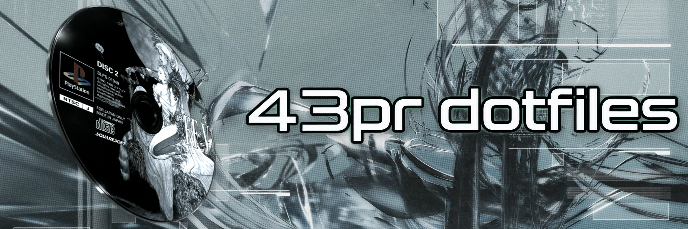
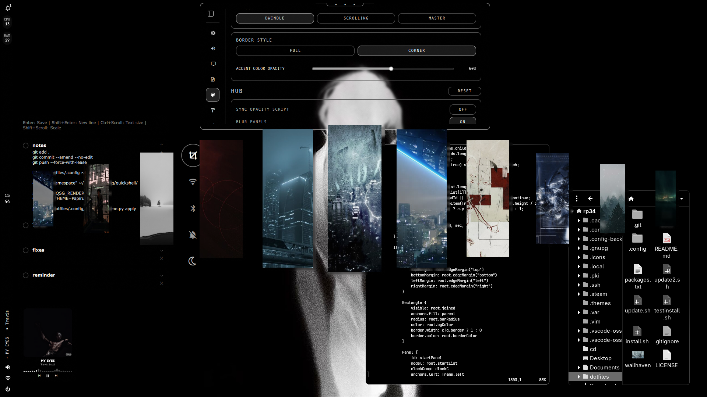

<div align="center">



# Enjin Arch dotfiles

### A cinematic, keyboard-first Hyprland desktop for Arch Linux

<p>
  <a href="https://archlinux.org/"></a>
  <a href="https://hyprland.org/"></a>
  <a href="https://www.gnu.org/software/bash/"></a>
</p>

<p>
  A ready-to-install personal Linux environment built around Hyprland, Quickshell,
  dynamic theming, polished wallpapers, and fast keyboard-driven workflows.
</p>

</div>

<div align="center">



</div>

## What this gives you

This repository turns a fresh Arch-based installation into a cohesive daily-driver
desktop. It brings the pieces together instead of treating them as isolated dotfiles:

- **Hyprland** with directional focus, window movement, resizing, workspace controls,
  borderless windows, and sensible monitor defaults.
- **Quickshell** for the top bar, widgets, wallpaper picker, theme picker, power menu,
  audio controls, notifications, and system information.
- **Dynamic appearance** powered by Matugen: choose a wallpaper and generate a matching
  palette for the shell, GTK, Kitty, Rofi, Hyprlock, and Quickshell.
- **A complete terminal workflow** with Kitty, Zsh, Starship, useful completions,
  JetBrains Mono Nerd Font, and quality-of-life aliases.
- **A safety-first installer** that detects Arch-compatible systems, installs packages,
  creates backups, and links the repository without deleting your existing setup.

## Install in a few minutes

> **Supported:** Arch Linux and Arch-based distributions such as EndeavourOS, CachyOS,
> and Manjaro. Use a normal user account with `sudo`; do not run the installer as root.

### 1. Get the repository

Install Git and clone the repository:

```bash
sudo pacman -S --needed git
git clone https://github.com/Amogh-007-Rin/Enjin-Arch-dotfiles.git ~/Enjin-Arch-dotfiles
cd ~/Enjin-Arch-dotfiles
```

Already copied the folder to this laptop? Just enter it:

```bash
cd ~/Enjin-Arch-dotfiles
```

### 2. Review before running

The installer is intentionally readable. Check the package list and make any hardware-
specific changes before continuing:

```bash
less packages.txt
less install.sh
```

The installer detects NVIDIA, AMD, Intel, and virtual GPUs. You can override detection
with `--gpu nvidia`, `--gpu amd`, `--gpu intel`, `--gpu vm`, or a comma-separated hybrid
selection. It can use `yay` or `paru`, and will offer to bootstrap `yay-bin` if no AUR
helper is available.

### 3. Install

```bash
chmod +x install.sh
./install.sh
```

For a non-interactive install, use the detected GPU stack and allow the installer to
skip AUR packages:

```bash
./install.sh --yes --no-aur
```

The installer will:

1. Verify that the machine is Arch-compatible and that `sudo`/`pacman` are available.
2. Resolve packages from the official repositories and the AUR.
3. Set Zsh as the default shell when it is installed.
4. Back up conflicting configuration files to `~/.config-backups/<timestamp>/`.
5. Generate hardware-specific GPU settings when needed and load them automatically.
6. Link this repository into `~/.config` and render machine-specific paths safely.
7. Create wallpaper/theme directories and generate the initial appearance.

Log out and back in, or restart your Hyprland session, after installation. The repository
must remain at its current path because the installed configuration points to it.

Preview the installer without guessing its options:

```bash
./install.sh --help
```

The installer is idempotent. Existing files are moved to a timestamped backup before
they are replaced, and the repository should remain at `~/Enjin-Arch-dotfiles` after
installation because the live configuration uses symlinks into the clone.

## Keyboard map

The setup is designed to be usable without reaching for a mouse.

| Shortcut | Action |
| --- | --- |
| `Super + Return` | Open Kitty terminal |
| `Super + D` | Application launcher |
| `Super + E` | File manager |
| `Super + B` | Default browser |
| `Super + W` | Wallpaper picker |
| `Super + T` | Theme picker |
| `Ctrl + Left/Right` | Previous/next workspace |
| `Super + Arrow` | Focus the monitor/window in that direction |
| `Ctrl + Shift + Arrow` | Move the focused window |
| `Super + Shift + Arrow` | Resize the focused tiled window |
| `Ctrl + Shift + P` | Power menu |

Arrow-key actions are directional: `Up`, `Down`, `Left`, and `Right` all work where
applicable. In an extended multi-monitor layout, a monitor in the requested direction
takes priority; otherwise the nearest window in the current workspace receives focus.
Resize shortcuts repeat in small increments when held.

## Multiple monitors

The display settings page supports **Extended** and **Mirrored** modes and remembers
the last valid position, scale, transform, and refresh rate for each output. In the
default arrangement, the external monitor can sit above the laptop: `Super + Up` moves
focus to it and `Super + Down` returns to the laptop. Workspace groups remain separated
by monitor when both outputs are connected.

Wallpaper output registration is repaired automatically after monitor hotplugging,
mirror/extend changes, reloads, and mode changes. The wallpaper picker also repairs the
output list before applying a new static or live wallpaper, so a monitor does not remain
black after being reconfigured.

## Daily use

| Task | How |
| --- | --- |
| Change wallpaper | Press `Super + W`, choose with the arrow keys, and confirm |
| Change theme | Press `Super + T`, choose a palette, and confirm |
| Reload Hyprland | Run `hyprctl reload` |
| Update the dotfiles | Run `./update.sh` and review the resulting Git diff |
| Inspect a failed install | Re-run the command and read the `[WARN]`/`[ERROR]` line |

Generated colors and runtime state are created on the machine that runs the setup; they
are deliberately not committed to this repository.

## Repository layout

```text
.
├── .config/           # Hyprland, Quickshell, shell, terminal and app configuration
├── assets/            # README preview images
├── docs/              # Setup notes and reference material
├── install.sh         # Safe first-time installer
├── update.sh          # Update/sync helper
├── packages.txt       # Official and AUR package manifest
├── SECURITY.md        # What must never be committed
└── .gitignore         # Generated, local and secret-file exclusions
```

## Safety and portability

- The installer refuses to run as root.
- Existing files are moved to a timestamped backup directory; they are not deleted.
- Configurations are symlinked so edits made from either the repository or `~/.config`
  update the same source file.
- Spotify's preferences path is rendered for the current user instead of preserving the
  original machine's absolute path.
- Generated palettes, caches, runtime state, credentials, recordings, and personal
  wallpaper collections are excluded. The repository includes only the selected default
  wallpaper used for the first-run appearance. Read [SECURITY.md](SECURITY.md) before
  publishing.

If you need to undo a change, remove the affected symlink and restore the corresponding
file from the latest directory under `~/.config-backups/`.

## Updating and contributing

Pull changes, inspect them, then re-run the installer when the layout changes:

```bash
git pull --ff-only
git diff HEAD~1..HEAD
./install.sh
```

Keep commits focused, never commit secrets, and test Hyprland syntax before pushing:

```bash
hyprland --verify-config -c .config/hypr/hyprland.lua
git diff --check
```

Made for a fast, expressive Arch desktop — tuned by Enjin.
